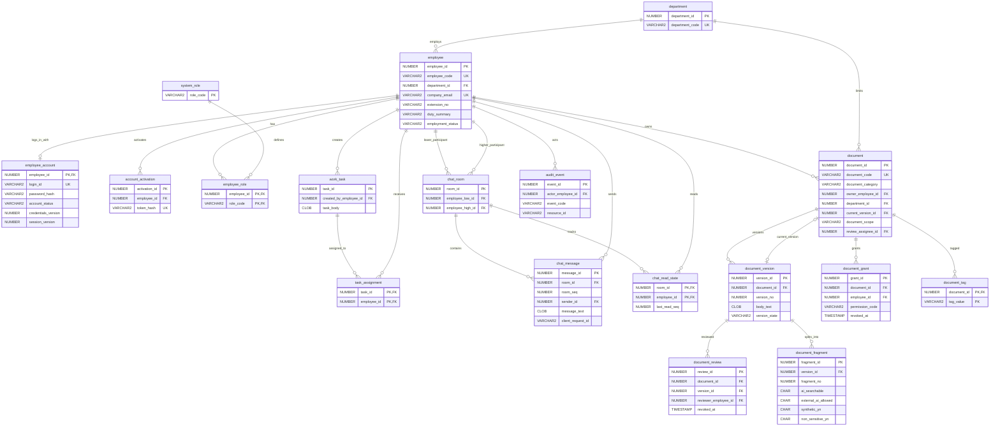

# Oracle 26ai ERD — STEP 18 현재 source

V001의 17개 업무 테이블에 V005의 document_tag를 더해 현재 18개다. 아래는 Oracle 전용 source 설계이며 실제 DB 적용은 BLOCKED: ORACLE_26AI_NOT_INSTALLED다. current_version은 document_version 생성 후 document_id까지 일치시키는 복합 FK로 추가한다. V004는 배정 검토자를 추가하고 V005는 tags/index를 추가한다. DDL/manifest bytes는 STEP 18에서 바꾸지 않았다.

`employee_account` separates credentials from the employee directory. `system_role` and `employee_role` separate security roles from job titles and departments. `document_review` records an approver and optional revocation; `document_grant` records a per-employee permission and optional revocation. `document_fragment` holds independent `ai_searchable` and `external_ai_allowed` flags. The database has no AI question, answer, prompt, transcript, or key table. `audit_event` stores metadata codes and IDs only.

V001은 합성 회사 이메일/내선/duty와 stable document_code/category를 포함하고 DISCARDED 상태를 지원한다. 메시지는 room/seq 및 sender/client_request_id의 unique 조건을 사용한다. 여기에는 AI transcript/key 테이블이 없다. [fixture-and-seed.md](fixture-and-seed.md)와 [Oracle 체크리스트](oracle-install-validation.md)를 따른다. 런타임 SQL/제약/락의 실제 수락은 전부 Oracle 설치 후 대기다.
