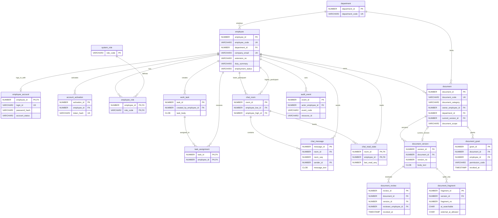

# STEP 04 Oracle 26ai ERD

All 17 requested candidate tables are retained. No extra application table was added. The relation labeled `current_version` is added **after** `document_version` exists, through a composite FK that also matches `document_id`.

`employee_account` separates credentials from the employee directory. `system_role` and `employee_role` separate security roles from job titles and departments. `document_review` records an approver and optional revocation; `document_grant` records a per-employee permission and optional revocation. `document_fragment` holds independent `ai_searchable` and `external_ai_allowed` flags. The database has no AI question, answer, prompt, transcript, or key table. `audit_event` stores metadata codes and IDs only.

STEP 05 refines the still-unapplied V001 schema with synthetic company email/extension/duty columns and stable `document_code`/category columns for rerunnable Oracle seed matching. `document_version.version_state` also accepts `DISCARDED` for withdrawn examples. The 17-table count and dependency graph are unchanged; V001's SHA-256 manifest was updated before any Oracle migration was executed. See `fixture-and-seed.md` for the 5/20/12/20 synthetic rows and the separate seed runner.
